# Task Management REST API

## Project Overview

This project is a full-stack Task Management application built with a Flask REST API backend and a React frontend.

The application allows users to register, log in, maintain authenticated sessions, and manage their own tasks through a RESTful API.

The backend implements CRUD operations, data validation, pagination, password hashing, and user-based authorization. The React frontend provides an authenticated interface for viewing tasks and navigating paginated results.

This project was developed as part of the Flatiron School curriculum.

## Features

### User Authentication

- Register users with unique usernames
- Securely hash passwords using Flask-Bcrypt
- Authenticate users using usernames and passwords
- Maintain authenticated sessions using Flask sessions and cookies
- Restore existing sessions when the React application loads
- Log users out by clearing their session
- Restrict task endpoints to authenticated users

### Task Management

- Create tasks associated with the authenticated user
- Retrieve tasks belonging to the authenticated user
- Retrieve individual tasks by ID
- Update individual or multiple task fields
- Delete existing tasks
- Prevent users from accessing or modifying tasks belonging to other users
- Return appropriate HTTP status codes for successful and unsuccessful requests

### Task Validation

- Require a non-empty task title
- Restrict status values to `pending`, `in_progress`, or `completed`
- Restrict priority values to `low`, `medium`, or `high`
- Validate task due dates using the `YYYY-MM-DD` format
- Reject malformed JSON request bodies
- Roll back database changes when validation fails

### Pagination

- Retrieve tasks using `page` and `per_page` query parameters
- Default to five tasks per page
- Return pagination metadata alongside task results
- Reject invalid pagination parameters
- Return an empty task list for pages outside the available results
- Display Previous and Next navigation controls in React
- Hide pagination controls when no task pages exist

### React Frontend

- Display login and signup interfaces
- Display an authenticated user dashboard
- Fetch tasks from the Flask backend
- Render task titles, descriptions, statuses, and priorities
- Display loading and error messages
- Display an empty state when no tasks are available
- Navigate between pages of tasks

The React task list is read-only. Task creation, updating, and deletion are supported through the Flask API.

---

## Technologies Used

### Backend

- Python
- Flask
- Flask-RESTful
- Flask-SQLAlchemy
- Flask-Migrate
- Flask-Bcrypt
- SQLAlchemy
- Marshmallow
- SQLite
- Faker

### Frontend

- React
- JavaScript
- HTML
- CSS
- Fetch API

### Development and Testing

- Pipenv
- pytest
- curl
- Git and GitHub
- Visual Studio Code
- SQLite Viewer

---

## Project Structure

```text
.
├── client-with-sessions/
│   ├── src/
│   │   ├── components/
│   │   │   ├── App.js
│   │   │   └── TaskList.js
│   │   └── pages/
│   └── package.json
├── server/
│   ├── app.py
│   ├── config.py
│   ├── helpers.py
│   ├── models.py
│   ├── schemas.py
│   ├── seed.py
│   └── migrations/
├── tests/
│   └── test_task_api.py
├── screenshots/
├── Pipfile
├── Pipfile.lock
└── README.md
```

### Important Files

| File | Description |
|---|---|
| `server/app.py` | Defines authentication and task API resources |
| `server/config.py` | Configures Flask, SQLAlchemy, migrations, bcrypt, and Flask-RESTful |
| `server/models.py` | Defines User and Task models, relationships, and validators |
| `server/schemas.py` | Defines Marshmallow schemas for JSON serialization |
| `server/helpers.py` | Contains reusable authentication, task ownership, and request-validation helpers |
| `server/seed.py` | Creates development users and sample tasks |
| `tests/test_task_api.py` | Contains automated backend integration tests |
| `client-with-sessions/src/components/App.js` | Handles session restoration and dashboard rendering |
| `client-with-sessions/src/components/TaskList.js` | Displays paginated tasks for the authenticated user |
| `screenshots/` | Contains application and API verification screenshots |

---

## Installation and Setup

### 1. Clone the Repository

Clone the repository and navigate into the project directory.

```bash
git clone https://github.com/Matt20Swanberg/flask-c10-summative-lab-sessions-and-jwt-clients
cd flask-c10-summative-lab-sessions-and-jwt-clients
```

### 2. Install Backend Dependencies

From the project root:

```bash
pipenv install
pipenv shell
```

### 3. Configure the Secret Key

The Flask application requires a `SECRET_KEY` environment variable for session security.

For local development:

```bash
export SECRET_KEY="$(python -c 'import secrets; print(secrets.token_hex(32))')"
```

Use a securely generated secret key for production environments.

### 4. Initialize the Database

Apply the existing database migrations:

```bash
flask --app server.app db upgrade
```

The migrations create the database tables and relationships.

### 5. Seed the Database

From the project root:

```bash
python -m server.seed
```

The seed script creates three development users and ensures each has five tasks.

Development accounts:

| Username | Password |
|---|---|
| John | `Johnpassword1` |
| Jane | `Janepassword1` |
| Bob | `Bobpassword1` |

These credentials are intended for local development only.

The script can be rerun without duplicating existing users or adding tasks beyond the configured target for each seeded user.

### 6. Start the Flask Backend

From the project root:

```bash
flask --app server.app run --debug --port 5555
```

The backend runs at:

```text
http://127.0.0.1:5555
```

### 7. Install and Start the React Frontend

Open a second terminal from the project root.

Install dependencies:

```bash
npm install --prefix client-with-sessions
```

Start React:

```bash
npm start --prefix client-with-sessions
```

The React frontend is configured to run at:

```text
http://localhost:4444
```

The frontend uses a proxy to communicate with the Flask backend on port `5555`.

---

## Database Models

### User Model

The `User` model stores authentication information.

| Attribute | Type | Description |
|---|---|---|
| `id` | Integer | Primary key |
| `username` | String | Required, unique username |
| `_password_hash` | String | Stored bcrypt password hash |

Each user can have multiple tasks.

#### Password Security

Passwords are never stored as plaintext.

The `password_hash` setter generates a bcrypt hash before storing it in `_password_hash`.

Attempting to read the `password_hash` property raises an `AttributeError`.

The `authenticate()` method verifies passwords against the stored hash.

### Task Model

The `Task` model stores individual tasks associated with users.

| Attribute | Type | Description |
|---|---|---|
| `id` | Integer | Primary key |
| `title` | String | Required task title |
| `description` | String | Optional task description |
| `status` | String | Task status |
| `priority` | String | Task priority |
| `due_date` | Date | Optional due date |
| `user_id` | Integer | Foreign key referencing the task owner |

#### Model Relationships

- A User has many Tasks
- A Task belongs to one User
- Each Task stores its owner's ID using the `user_id` foreign key

#### Task Validations

- Title must be a non-empty string
- Status must be `pending`, `in_progress`, or `completed`
- Priority must be `low`, `medium`, or `high`
- Due dates must be valid dates
- String-formatted due dates must follow `YYYY-MM-DD`

---

## API Endpoints

### Authentication Endpoints

| Method | Endpoint | Description |
|---|---|---|
| POST | `/signup` | Register a new user |
| POST | `/login` | Authenticate a user |
| GET | `/check_session` | Verify an existing session |
| DELETE | `/logout` | End the current session |

### Task Endpoints

| Method | Endpoint | Description |
|---|---|---|
| GET | `/tasks` | Retrieve paginated tasks belonging to the current user |
| POST | `/tasks` | Create a new task |
| GET | `/tasks/<id>` | Retrieve an owned task |
| PATCH | `/tasks/<id>` | Update an owned task |
| DELETE | `/tasks/<id>` | Delete an owned task |

All task endpoints require authentication.

### Common HTTP Status Codes

| Status | Meaning |
|---|---|
| 200 | Successful request |
| 201 | Resource created successfully |
| 204 | Successful deletion or logout |
| 400 | Invalid request format or pagination parameters |
| 401 | Authentication required or invalid credentials |
| 404 | Task does not exist or does not belong to the current user |
| 422 | Validation error |

---

## API Examples

### Log In

```bash
curl -i -c /tmp/task_session.txt \
  -X POST http://127.0.0.1:5555/login \
  -H "Content-Type: application/json" \
  -d '{
    "username": "John",
    "password": "Johnpassword1"
  }'
```

The `-c` option saves the Flask session cookie.

Subsequent requests use `-b` to include the saved cookie.

### Retrieve Tasks

```bash
curl -i -b /tmp/task_session.txt \
  http://127.0.0.1:5555/tasks
```

### Retrieve Paginated Tasks

```bash
curl -i -b /tmp/task_session.txt \
  "http://127.0.0.1:5555/tasks?page=1&per_page=2"
```

The response includes pagination metadata and task records:

```json
{
  "page": 1,
  "per_page": 2,
  "total": 5,
  "total_pages": 3,
  "items": [
    {
      "id": 1,
      "title": "Example Task",
      "description": "Example task description",
      "status": "pending",
      "priority": "medium",
      "due_date": "2026-12-01",
      "user_id": 1
    }
  ]
}
```

This is an illustrative response. Actual task data and counts will depend on the database.

### Create a Task

```bash
curl -i -b /tmp/task_session.txt \
  -X POST http://127.0.0.1:5555/tasks \
  -H "Content-Type: application/json" \
  -d '{
    "title": "Complete API Documentation",
    "description": "Document all Task Management API endpoints",
    "status": "pending",
    "priority": "high",
    "due_date": "2026-12-15"
  }'
```

Expected status: `201 CREATED`

### Update a Task

Replace `TASK_ID` with the ID of a task belonging to the authenticated user.

```bash
curl -i -b /tmp/task_session.txt \
  -X PATCH http://127.0.0.1:5555/tasks/TASK_ID \
  -H "Content-Type: application/json" \
  -d '{
    "status": "completed",
    "priority": "medium"
  }'
```

Expected status: `200 OK`

### Delete a Task

Replace `TASK_ID` with the ID of a task belonging to the authenticated user.

```bash
curl -i -b /tmp/task_session.txt \
  -X DELETE http://127.0.0.1:5555/tasks/TASK_ID
```

Expected status: `204 NO CONTENT`

### Verify Authentication Protection

```bash
curl -i http://127.0.0.1:5555/tasks
```

Expected status: `401 UNAUTHORIZED`

Unauthenticated users cannot retrieve task data.

---

## React Frontend Integration

The React frontend communicates with the Flask backend through the configured proxy.

### Session Management

When the application loads, `App.js` sends a request to `/check_session`.

If the session is valid, the authenticated user is stored in React state and the dashboard is displayed.

Otherwise, the login interface is displayed.

### TaskList Component

The custom `TaskList.js` component:

- Uses `useState` to manage tasks, pagination, loading, and errors
- Uses `useEffect` to fetch tasks when the component loads or the current page changes
- Requests five tasks per page
- Displays task information returned by the API
- Provides Previous and Next navigation
- Disables navigation buttons when appropriate
- Displays an empty-state message when no tasks exist
- Hides pagination controls when the total page count is zero

### User Isolation

The Flask backend determines the authenticated user from the session.

Task queries are filtered using the current user's ID.

The frontend does not determine task ownership, ensuring that users cannot retrieve another user's tasks simply by modifying frontend requests.

---

## Automated Testing

The backend uses `pytest` to verify API behavior.

### Run the Test Suite

From the project root:

```bash
python -m pytest -v --tb=short tests/test_task_api.py
```

### Test Coverage

The automated tests cover:

- User registration
- Invalid signup requests
- Authentication requirements
- Task updates
- Single-field and multiple-field updates
- Invalid task values
- Database rollback after failed updates
- Task deletion
- Missing task handling
- Task ownership restrictions
- Default pagination
- Pagination across multiple pages
- Out-of-range pagination
- Invalid pagination parameters

### Test Database Isolation

The test suite uses a temporary SQLite database.

Each test runs with its own database setup, and the original database engine is restored during cleanup.

This prevents automated tests from modifying the development database.

---

## Screenshots

The following screenshots demonstrate the application interface, API functionality, and automated testing.

### Application Startup

#### Flask Backend

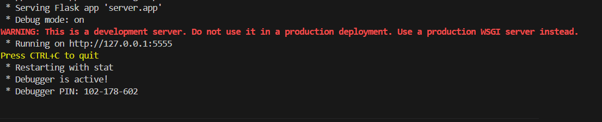

#### React Frontend

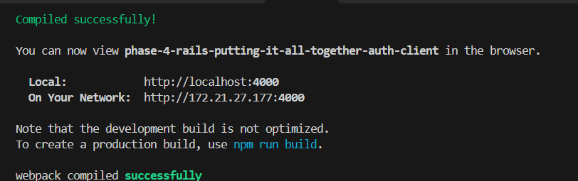

### User Authentication

#### Signup

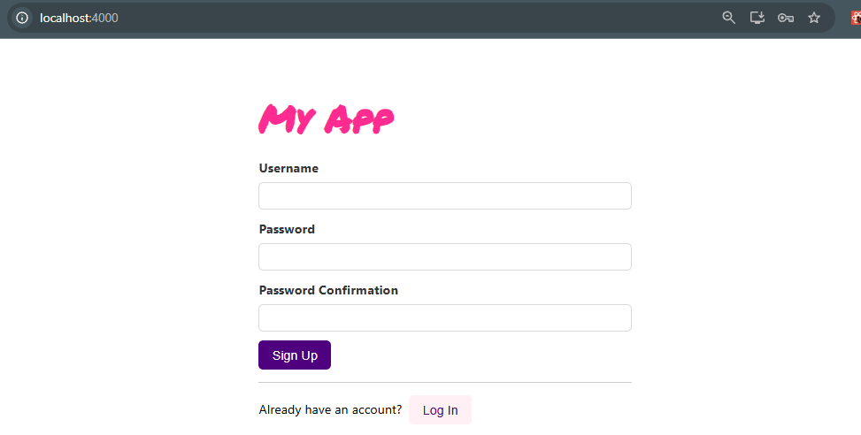

#### Login

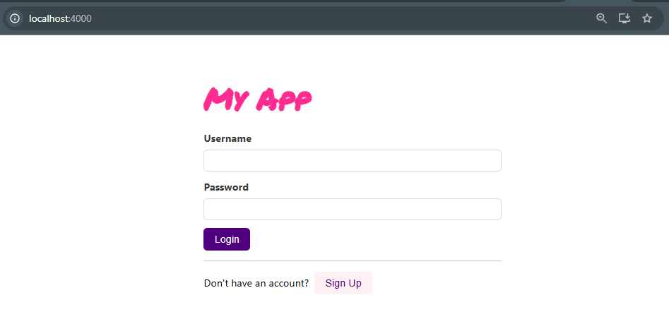

#### Successful Login

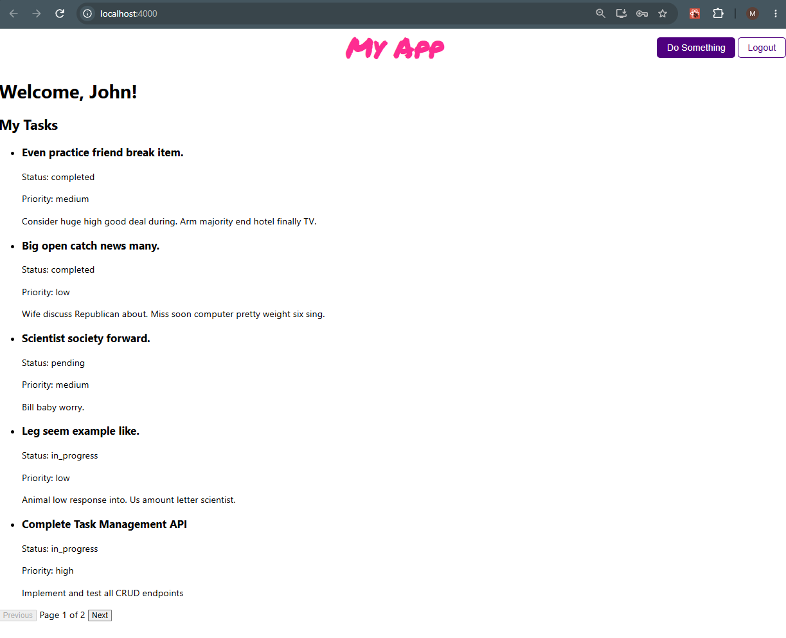

#### Failed Login

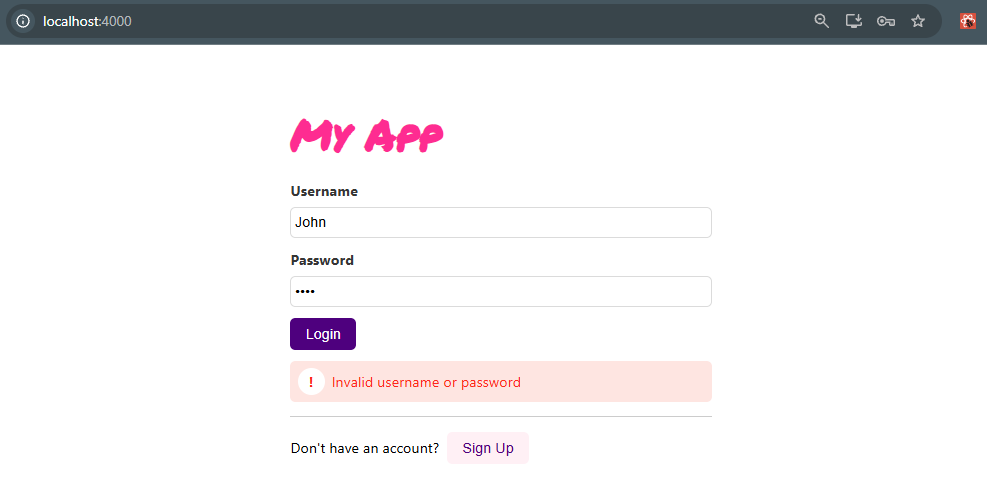

### Task Management

#### Task Creation

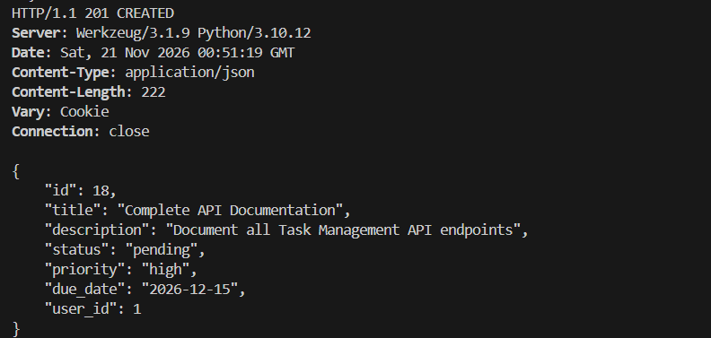

#### Task Update

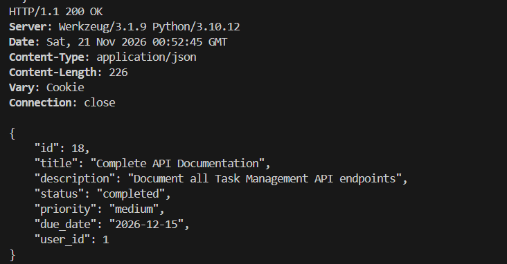

#### Task Deletion

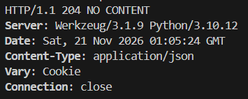

### Task Pagination

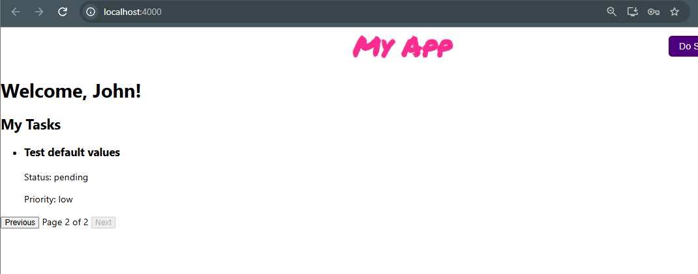

### Empty Task State

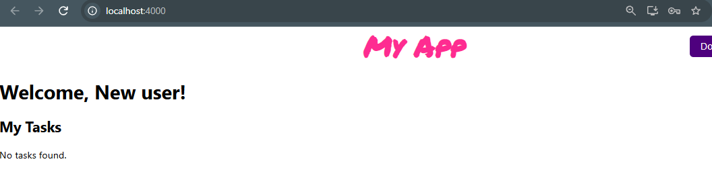

### API Security

#### Unauthorized Task Access

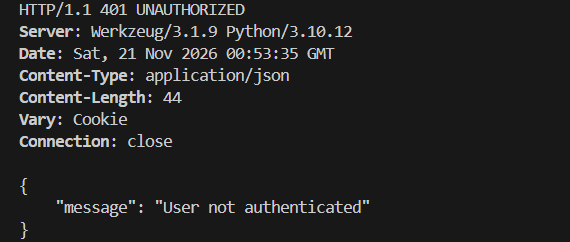

### Automated Test Suite

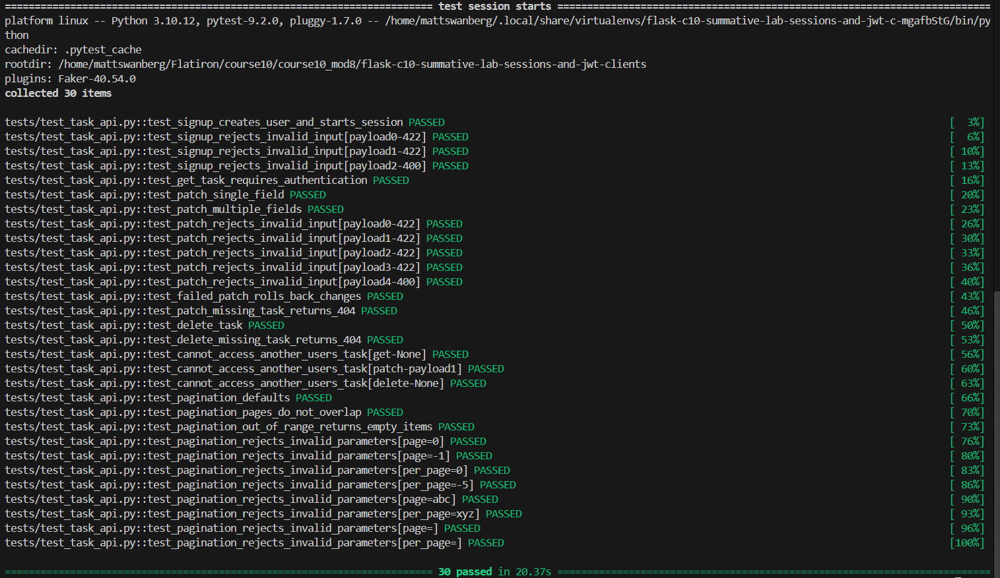

---

## Security Considerations

- Passwords are hashed using bcrypt
- Password hashes are excluded from API responses
- Flask sessions track authenticated users
- Task endpoints require authentication
- Task ownership is enforced on the backend
- Invalid requests return appropriate HTTP errors
- Failed database updates are rolled back
- The Flask secret key is loaded from an environment variable
- Development credentials are intended for local testing only

---

## Future Improvements

Potential future enhancements include:

- Creating tasks directly through the React interface
- Editing tasks through the React interface
- Deleting tasks through the React interface
- Filtering tasks by status and priority
- Sorting tasks by due date
- Searching tasks by title
- Adding frontend form validation
- Improving dashboard styling and responsive layouts

---

## Conclusion

This project demonstrates the development of a full-stack application using Flask, SQLAlchemy, and React.

The backend provides authenticated CRUD operations, data validation, pagination, and task ownership restrictions.

The frontend integrates session authentication and paginated task retrieval.

Automated tests and manual API verification demonstrate the application's core functionality.

## Author

Created by Matthew Swanberg as part of Course 10 Module 8 (Summative Lab: Full Auth Flask Backend- Productivity App)